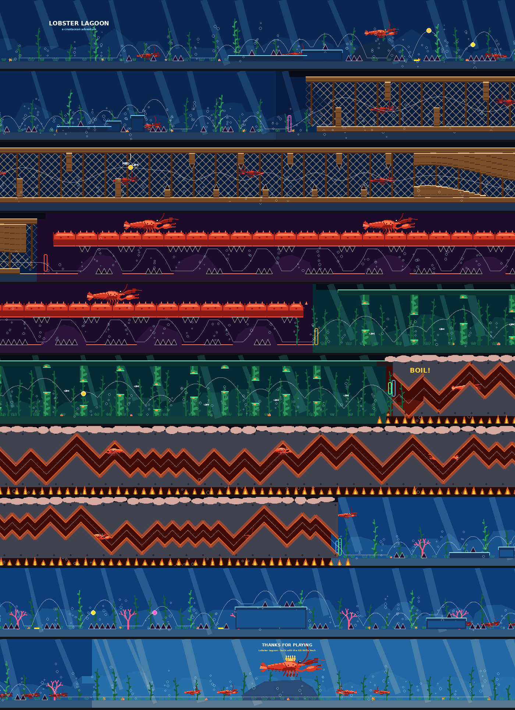

# Lobster Lagoon 🦞

A lobster-themed Geometry Dash 2.2 level, built with the
[GD Skills Pack for Claude](https://github.com/Mifu999/GD-Skills-Pack-for-Claude).
Object IDs, property keys, physics and file formats come from that pack's
`gd-docs` and `gd-editor-guide` skills.



| | |
|---|---|
| **Song** | *The Seven Seas*, F-777 (official song, no download needed), 140 BPM |
| **Length** | 1:26 (Long), 200 beats |
| **Gamemodes** | cube → ship → ball → UFO → wave (2x) → cube |
| **Coins** | 3 user coins |
| **Objects** | ~46,000 (under the 80k limit, no "unlimited objects" needed) |
| **Difficulty (my estimate)** | Harder, roughly 6–7★ |

## The story, section by section

| Beats | Time | Section | Mode | What happens |
|---|---|---|---|---|
| 0–32 | 0:00 | **Seafloor** | cube 1x | Title card, kelp swaying in time with the music, light rays, lobsters walking along the sand. Spikes are sea urchins; rock platforms, a pad and an orb jump. Coin 1 is at the top of the pad jump. |
| 32–64 | 0:14 | **The Trap** | ship 1x | Inside a wooden lobster trap: net mesh, wooden slats you weave between, other trapped lobsters bobbing behind the net, and a bait bag of fish (coin 2 is inside it). Ends in a narrowing funnel. |
| 64–96 | 0:27 | **Claw Tunnel** | ball 1x | You roll under the arm of a giant lobster. Its barbs are the spikes on the ceiling, and three giant claws above snap on every beat. |
| 96–120 | 0:41 | **Kelp Forest** | UFO 1x | Thirteen giant-kelp gates that get tighter and faster, with a swaying kelp forest behind them. Coin 3 is in the sixth gate. |
| 120–152 | 0:51 | **BOIL!** (drop) | wave 2x | Caught and dropped in the pot. The palette switches to red, with shake, a shockwave and a camera zoom. The pot walls zig-zag with the music, and there are quarter-beat "spam" bursts at beats 128, 140 and 146. Flames flicker, bubbles and steam rise, and the background pulses on every beat. |
| 152–184 | 1:05 | **Escape** | cube 1x | Back in open water, brighter. Orbs, pads, a 4-block pad launch and a lobster parade. A lobster swims alongside you the whole time. |
| 184–200 | 1:19 | **Lobster King** | cube | Victory lap: the Lobster King on his rock throne with his court, "Thanks for playing", a slow camera zoom-out, then the end trigger. |

## How to put it in your game

**Option A, with Geode (easiest):** install [Geode](https://geode-sdk.org/), add a
level-import mod such as **GDShare**, then use its import button in *Create* and
pick `Lobster_Lagoon.gmd`.

**Option B, no mods:** close Geometry Dash and run

```
python install_level.py
```

It finds `CCLocalLevels.dat` (Windows, macOS, or Steam/Proton on Linux), saves a
timestamped backup next to it, and adds *Lobster Lagoon* at the top of your
created levels. If your save is somewhere else, pass `--save PATH`. On macOS you
need `pip install pycryptodome` first.

Then open the level, playtest it, and verify it before uploading. You can't
upload a level you haven't beaten yourself.

## How it was checked

`verify.py` plays the whole level with a bot that uses GD's documented physics
(`gd-docs` reference/player_physics) at 240 ticks per second. See
`verification_report.txt` for the full output.

- **Full run:** completes with **3/3 coins**.
- **Unknown physics values:** the docs don't give ball gravity, UFO gravity or
  ship thrust, so the bot replays the level with a range of values for each.
  All 12 runs pass. For the UFO it doesn't use a heuristic: it searches every
  click timing to prove a path exists through the kelp.
- **Room to fly:** the ship, UFO and wave never come closer than about half a
  block (14–15 units) to a block or spike.
- **Click timing:** a cube click works anywhere in a window of about 106 ms on
  average, and a ball flip in about 233 ms. The tightest cube clicks are
  back-to-back jumps where you'd normally just hold.
- **Hitboxes:** the bot treats spikes as larger than they really are (9×21
  units instead of about 6×12). The real game should be at least this
  forgiving.

The level string was also run through the skill pack's `gd.py parse`, and every
property key is valid for its object class. The `.gmd` round-trips byte for
byte.

## Things to know (honest caveats)

- **Music sync is by the grid, not by ear.** I couldn't listen to the song, so
  every click, flip, portal, pulse and kelp sway sits on a 140 BPM grid starting
  at 0:00. The drop is placed at beat 120 (0:51) as a best guess. If it doesn't
  line up with the song's drop, change the song offset in level settings or move
  the drop. The editor guidelines are included (green on each bar), which makes
  this easy.
- **Shape sizes.** Squares and slopes have exact sizes. The bubble circles and
  text are drawn at sizes I assumed, so they may look a little bigger or smaller
  in game than in the previews.
- **Shockwave values.** The shockwave at the drop uses moderate values I picked
  myself. Tweak it if it's too strong or too weak.
- **Previews are approximate.** They show starting positions and apply colour
  changes instantly. Moving parts (claws, kelp, bubbles, lobsters) only animate
  in game.
- **Decoration has no hitbox.** All decoration is set to *NoTouch*, so only the
  gameplay blocks and spikes can kill you.

## Remixing it

Everything is generated from code, so you can change the design and rebuild:

```
python3 build_level.py    # writes Lobster_Lagoon.gmd (and level_string.txt)
python3 verify.py         # plays it and checks every section
python3 render_preview.py # redraws preview/*.png
```

| File | What it is |
|---|---|
| `build_level.py` | The level design: palettes, the seven sections, triggers |
| `art.py` | Lobster, kelp, rocks, coral, starfish, flames, crown… |
| `gdkit.py` | Small GD toolkit: objects, triggers, convex polygons → squares + slopes, `.gmd` encoding |
| `physics.py` | Tick-based player physics used by the bot |
| `verify.py` | The play-testing bot and report |
| `render_preview.py` | Preview renderer |
| `install_level.py` | Adds the `.gmd` to your save without mods |
